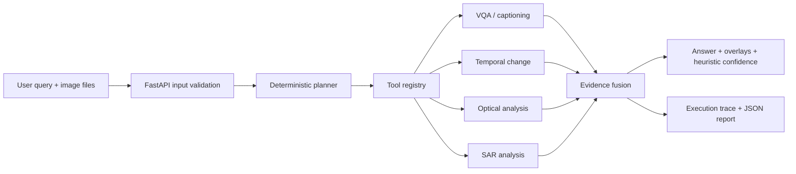

# SatQuery AI


> Ask natural-language questions about satellite imagery and inspect the tools and evidence behind each answer.


SatQuery is a local-first prototype for query-driven remote-sensing analysis. Upload one image, a before/after pair, or a co-registered optical/SAR pair. A deterministic router validates the inputs, selects registered analysis tools, combines their evidence, and returns a result with visual overlays, heuristic confidence indicators, and an execution trace.

**Best starting point:** [Quickstart](QUICKSTART.md) · **Design details:** [Architecture](docs/ARCHITECTURE.md) · **Demo walkthrough:** [Demo script](docs/DEMO_SCRIPT.md)

## What works today

| Area | Current implementation |
|---|---|
| Local web app and API | FastAPI serves the bundled demo UI and `/api` endpoints |
| Query routing | Deterministic intent and input-based planning |
| Image validation | File/type/size and task compatibility checks with explicit errors |
| Analysis tools | Heuristic VQA/captioning, change detection, optical/SAR evidence and fusion |
| Results | Answer, evidence overlays, confidence metadata, execution trace and JSON reports |
| Demo | Included sample data supports offline walkthroughs |
| Optional model training | LoRA training scaffolding exists; a trained checkpoint is not enabled by default |

This is a research/demo prototype. The current analysis tools use image heuristics and proxy indices; confidence is **not a calibrated probability**. Grounding is heuristic, optical/SAR co-registration is assumed rather than performed, and performance on other sensors or geographic domains has not been established. Do not use it as the sole basis for operational or safety-critical decisions.

## Architecture



The registry is defined in [`config/tool_registry.yaml`](config/tool_registry.yaml). See [`docs/ARCHITECTURE.md`](docs/ARCHITECTURE.md) for implementation details.

## Quick start

### Requirements

- Python 3.10 or newer
- Windows, macOS or Linux
- No model download is required for the included heuristic demo

### Install and run

```bash
git clone https://github.com/spaxe-dev/satquery.git
cd satquery
python -m venv .venv
# Windows PowerShell: .venv\Scripts\Activate.ps1
# macOS/Linux: source .venv/bin/activate
python -m pip install -r backend/requirements.txt
python scripts/prepare_demo_data.py
python -m uvicorn backend.app.main:app --host 127.0.0.1 --port 8000
```

Open [http://localhost:8000](http://localhost:8000). API health and interactive docs are at `/api/health` and `/docs`.

For Windows convenience, `scripts/start.ps1` is also available. See [QUICKSTART.md](QUICKSTART.md) for the UI demo flow, API examples, PDF reports, and optional GPU training setup.

## Example API request

```bash
curl -X POST http://localhost:8000/api/analyze \
  -F 'query=What changed between these two dates?' \
  -F 'images=@data/demo/temporal_pairs/flood_T1.png' \
  -F 'images=@data/demo/temporal_pairs/flood_T2.png'
```

The analyze endpoint accepts a query and up to four image uploads. The response includes the answer, selected tools, evidence and an execution trace. See [`docs/API_ARCHITECTURE.md`](docs/API_ARCHITECTURE.md) for endpoint and response details.

## Project structure

```text
satquery/
├── agent/                 # Intent routing and tool planning
├── backend/app/           # FastAPI app, routes, validation and orchestration
├── tools/                 # VQA, change, optical, SAR and fusion tools
├── packages/              # Shared schemas, geospatial helpers and dispatch
├── config/                # Settings and allow-listed tool registry
├── frontend/              # Bundled offline demo UI
├── apps/web/              # Next.js interface work in progress
├── data/demo/             # Small demo fixtures
├── datasets/              # Dataset manifests and processed examples
├── training/              # Optional fine-tuning pipeline
├── docs/                  # Architecture, model card, evaluation and plans
└── tests/                 # Automated checks
```

The primary local demo is the bundled UI served by FastAPI. `apps/web/` is a separate Next.js interface under development; the default quickstart does not run it.

## Development

```bash
python -m pytest tests -v
```

To validate or regenerate demo assets, see `scripts/prepare_demo_data.py` and `scripts/verify_datasets.py`. Optional training requires additional GPU-oriented dependencies; begin with [`docs/CLOUD_GPU_SETUP.md`](docs/CLOUD_GPU_SETUP.md) and [`docs/MODEL_CARD.md`](docs/MODEL_CARD.md).

## Data and model notes

- Demo assets are included for local evaluation; respect the original source licenses when adding external datasets.
- Dataset download and training scripts are optional and may require separate accounts, storage and compute.
- The heuristic tools are the default inference path. Fine-tuned model support is experimental and does not replace evaluation on held-out imagery.
- Do not commit credentials, private imagery, model checkpoints or generated reports containing sensitive data.

## Contributing

Please open an issue before a substantial feature so the scope and expected evidence can be agreed. Pull requests should explain the change, note any new data or model requirements, and include relevant test or demo results. Keep performance and accuracy claims tied to reproducible evaluation.

## License

No license is currently declared. Unless a license is added, reuse and redistribution are not granted by default.
