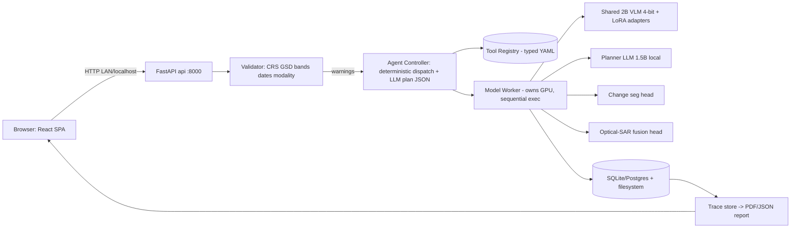

# SIH26167 — SatQuery AI - An Interactive Vision-Language Assistant for Multimodal Remote Sensing Image Analysis through Text Queries

Final technical due-diligence synthesis. Sources: [PS] official SIH problem statement; [DEL] completed deliberation (final.md, final-judge.md, competition.md, scientist.md, technical.md, feasibility.md); [EXT] externally verified current information (as of deliberation, Aug 2026; re-verify at project start); [EST] engineering estimate/inference; [UNK] unknown, requires validation.

Inputs: analysis/technical.md, analysis/deployment.md, analysis/economics.md, analysis/student.md, plus deliberation/competition.md and deliberation/final-judge.md for the strategic sections (19–20). No new research was performed.

---

## 1. Executive Verdict

**What the organization wants.** ISRO/SAC wants a natural-language front-end over multiple remote-sensing specialist models [PS]: a user uploads satellite imagery (single image, bi-temporal pair, or optical–SAR pair) and asks questions in plain language. The PS mandates five capabilities: (1) fine-tune/adapt at least one vision/vision-language component using BigEarthNet or other open data; (2) single-image VQA plus captioning OR grounding; (3) bi-temporal change analysis; (4) joint optical–SAR pair analysis; (5) agentic orchestration with an auditable execution trace. A generic LLM/VLM wrapper is explicitly disqualified [PS].

**What we would actually build.** "SatQuery AI": a React + FastAPI web application backed by one shared ~2B-class quantized VLM with task-specific LoRA adapters (single-image QA, temporal change, SAR), two small specialist heads (change segmentation, optical–SAR multi-label classifier), a deterministic agent controller with an LLM intent-parser, a metadata-first input validator, and full execution traces rendered as downloadable audit reports. Fully offline at runtime; single 24GB GPU node; Docker Compose deployment with an offline install bundle.

**Why it is attractive.** Every mandated capability has open prior art and free datasets [DEL][EXT]; zero mandatory recurring cost; no sensors; deliberately minimal infrastructure; a demo design (live adversarial inputs, auditable traces, calibrated uncertainty) that is demonstrably stronger than the median Gradio-wrapper submission [DEL]; high judge-visible impact narrative (non-expert access to satellite imagery).

**Why it is dangerous.** The ML layer is genuinely hard: three LoRA runs on unfamiliar formats, SAR-grounded language with no public paired text corpus, and an unbridgeable training-to-evaluation domain gap (Sentinel 10m Europe → Cartosat-2S sub-meter + RISAT India) [DEL]. The gating dependency — ≥2 members with hands-on fine-tuning experience and guaranteed ≥24GB GPU access — is unconfirmed [UNK]. Integration risk is where SIH teams die ("four half-working specialists behind a shell") [DEL].

**Can a strong second-year team execute it?** Yes, conditionally. The plan is executable by 4–6 committed people over 10–14 weeks *if* the week-1 evidence gate passes (GPU confirmed, datasets checksummed, one QLoRA run completed) and *if* scope discipline holds (simplify to one multi-task LoRA if capability is thin) [DEL][EST]. It is not achievable casually alongside heavy semester load [EST].

**Biggest opportunity.** The optical–SAR + bi-temporal combination under an auditable controller with honest confidence reporting. No public system does all of this; Indian-sensor adaptation is the one axis prior art cannot be copied on; and "a system that says 'I'm uncertain, here's why' while rivals bluff" reads as maturity to SAC evaluators [DEL].

**Biggest risk.** Zero-execution track record attached to a top-tier plan: as of deliberation end, no dataset had been downloaded, no weights run, GPU ownership unknown, evaluation format unasked [DEL]. If the week-1 gate fails, this collapses to the median submission. Secondary: hidden-set domain shift caps scores for everyone and can make the optical–SAR component fail live.

**Verdict: CONDITIONAL.**
Justification: the problem is real, fully scoped, cheap, demo-rich, and matches our capability ceiling almost exactly — but only under explicit conditions that are already defined: (a) week-1 gate artifacts produced (GPU confirmed, checksummed downloads, one completed LoRA run, EarthMind evaluated, ISRO format inquiry sent); (b) Gate-2 stub skeleton passing a compound-query test; (c) written commitment to abandon-or-simplify per the documented fallback tree if gates fail. Unconditionally recommending a project whose entire evidence base is still paper would be dishonest; rejecting a top-quartile plan with genuine winner potential would be timid.

---

## 2. The Problem in Plain Engineering Language

In plain language: scientists and analysts at ISRO work with satellite images that require expert tooling to interpret. The PS asks for a chat-style assistant: give it an image (or two), ask "what is in this?", "what changed between these two dates?", "what does the radar version say about this area?" — and get a factual answer with visual evidence, a confidence level, and a traceable log of which models were used and why. Crucially, the assistant must be built from remote-sensing-adapted models (not a generic ChatGPT wrapper), must handle radar imagery as well as optical, must orchestrate several specialist tools intelligently, and must explain itself.

Engineering specification:

| Dimension | Specification |
|---|---|
| Inputs | Single GeoTIFF/TIFF/PNG/JPEG chip; co-registered bi-temporal pairs; co-registered optical–SAR pairs (assumed pre-georeferenced [PS]); natural-language query |
| Outputs | Short factual answer; confidence label; visual evidence (bounding boxes, change maps, land-cover overlays); JSON + PDF execution report (task, tools, params, timings, warnings) |
| Users | Non-expert imagery consumers; SAC evaluators; potentially analysts during pilot |
| Constraints | Offline at inference (no external LLM/API calls) [DEL]; RS-adapted models mandatory; BigEarthNet-based adaptation mandatory [PS]; generic wrappers disqualified [PS] |
| Latency | <30 s typical query on one 24GB GPU; 60–90 s worst case for compound queries chaining 2–3 tools [EST] |
| Accuracy | Unknown scoring regime on a hidden Cartosat-2S (~0.65m pan) + RISAT set [UNK]; train toward closed-vocab short-factual answers as the robust intersection [DEL] |
| Hardware | One ≥24GB GPU (dev/train/demo); 64GB RAM recommended; ~250GB NVMe; no cluster |
| External dependencies | Build-time only: HF Hub, Zenodo, GitHub, Copernicus Data Space (free), optional Bhoonidhi/NRSC (registration, restricted license). Runtime: none |
| Environment | Demo: air-gapped localhost/LAN. Pilot: institution/SAC machine via offline bundle. Production: SAC on-premise [EST/UNK] |

The dominant engineering difficulty is not any component (all have prior art) but composing five ML components into one offline, single-GPU, demo-stable system whose inputs come from sensors no public training data matches [DEL].

---

## 3. What We Would Actually Build

A web application where the user uploads imagery, types a question, and receives a grounded, evidenced, auditable answer.

- **Frontend:** React + TypeScript + Vite SPA; drag-drop upload (single/pairs); chat query panel; tabbed results (Answer / Evidence overlay / Execution trace / Report download); validator warning banners; polling-based job status.
- **Backend:** Python 3.11 / FastAPI / Uvicorn, split into an API process (routing, validation orchestration, sessions, reports) and a model worker process owning the GPU, loading models once at startup, executing tools sequentially.
- **Database:** SQLite (demo) / PostgreSQL (pilot+): users, requests, append-only execution traces, validator events, artifact index, model registry. Filesystem object store (`data/uploads/{request_id}/`).
- **ML:** shared quantized 4-bit 2B-class VLM (Qwen2-VL-2B class, Apache-friendly) + three LoRAs; planner LLM (Qwen2.5-1.5B/3B class, local, JSON-schema-constrained); change-segmentation head (Siamese U-Net/ChangeFormer-lite); optical–SAR dual-encoder classifier (start from BIFOLD-BigEarthNetv2 pretrained weights [EXT]).
- **Data pipeline:** rasterio/GDAL ingestion scripts; checksummed downloads of reBEN v2.0, CDVQA, OSVQA, RSVQA, VRSBench; template-QA synthesis for SAR weak supervision; on-the-fly augmentation (resolution jitter, speckle injection, radiometric jitter, cloud synthesis).
- **APIs:** internal REST (`/api/upload`, `/api/query`, `/api/query/{id}`, report/trace downloads, `/api/tools`). No external runtime APIs by design.
- **Hardware:** one 24GB GPU workstation serving dev, training, and demo roles.
- **Auth:** demo bypass honestly labeled; pilot adds hashed credentials + two server-side roles.
- **Monitoring:** health/readiness endpoints, pre-flight checklist script, nvidia-smi rehearsal logging; no monitoring stack.
- **Deployment:** Docker Compose (api + worker + db), pinned CUDA base image, offline bundle (docker save tarball + weights + demo scenes), CPU degraded-mode fallback.

Complete flow: upload → metadata extraction (rasterio) → validation (flag-don't-reject; hard-fail only on format errors) → intent parsing into a schema-validated plan JSON → deterministic dispatch through the tool registry (VQA/captioning LoRA-A; change-VQA temporal LoRA-B; optical–SAR fusion classifier + template NLG; grounding seg head) → cross-modal consistency check (optical-derived vs SAR-derived indicators; disagreement becomes a flag) → answer assembly (text + confidence + overlays) → trace persisted → PDF/JSON report → frontend render.

---

## 4. Technical Architecture

### Frontend
React + TypeScript + Vite, static build served by nginx inside the api container. No SSR, no Node at runtime, no CDN/external fonts (offline constraint). Plain canvas overlays rather than a mapping SDK — inputs are chips/pairs, not global scenes. Polling over WebSockets (deliberately less fragile live). Why: demo-critical surface; reliability beats polish.

### Backend
FastAPI + Pydantic: typed schemas double as tool-registry contracts. Two process classes (CPU api, GPU worker) so a model crash never takes down routing. Deterministic dispatcher; LLM used only as constrained planner; malformed plans fall back to a regex/keyword classifier. Why: reproducibility under benchmark scoring; LLM-planner flakiness loses points.

### Database
SQLite for the demo (zero ops); Postgres from pilot onward with Alembic migrations from day one. Append-only traces are both a product feature (judges see them) and the audit log. Why: minimal ops; the trace-as-audit requirement needs structure, not scale.

### AI/ML
Shared-backbone + LoRA-adapters (not four unrelated models) resolves integration and VRAM residency in one stroke (~8–12GB total resident). Specialist heads cover what VLMs measure badly (grounding IoU) and what needs labels (fusion). Hybrid SAR design: physics-grounded template floor (backscatter statistics → land-cover statements, no ML) guarantees non-trivial optical–SAR output even if fine-tuning disappoints; supervised ceiling evaluated separately. Confidence: verbalized + consistency-based, explicitly not claimed as calibrated probabilities.

### Data Pipeline
Plain invoke scripts, not Airflow/Dagster (five pipelines don't justify orchestration tooling). Dataset manifests (source URL, sha256, transform config) in git replace DVC. On-the-fly augmentation in the DataLoader implements the domain-shift hedge.

### APIs
Internal REST only, versioned `/api/v1` from day one; OpenAPI ships free. Async pattern: query returns a request id immediately; status polled. Download-time externals: HF Hub, Zenodo, Copernicus OData, Bhoonidhi.

### Hardware
One ≥24GB GPU (owned RTX 3090/4090 or rented); 64GB RAM; ~250GB NVMe. No cluster, no multi-GPU, no TPU. Deliberately not overengineered.

### Infrastructure
Docker Compose, pinned CUDA base, hash-locked requirements; CI = lint + unit tests + stub-model e2e smoke (no GPU in CI); tagged releases produce the offline bundle. No Kubernetes — single node, one GPU, sequential execution, zero elasticity need.

---

## 5. Data Feasibility

| Dataset | Source / availability | API | Price | Real-time | Volume | Labels | Ownership / legal | Fallback |
|---|---|---|---|---|---|---|---|---|
| BigEarthNet v2.0 (reBEN-MM) | Zenodo record 10891137, direct links [EXT] | HTTP | Free | N/A (archive) | ~110GB, ~550k S1/S2 pairs, 10m | Multi-label 19-class CORINE | CDLA-Permissive [EXT] | Documented subset instead of full archive ("BigEarthNet.txt" interpretation pending [UNK]) |
| CDVQA | Public GitHub repo with documented splits [EXT] | Git | Free | N/A | 2,968 aerial pairs, 122k QA | Change QA | Academic release | SECOND masks + own template QA; tiny pool caps quality regardless |
| OSVQA/TGFNet | github.com/mmic-lcl [EXT] | Git | Free | N/A | 6,008 optical–SAR pairs, ~1.04M QA, 140 answers, ~10m 256px | Optical-SAR QA | Academic release | reBEN-MM template-QA synthesis + speckle-augmented variants |
| RSVQA / VRSBench | Site / HF xiang709/VRSBench [EXT] | HTTP/HF | Free | N/A | Large eval sets | VQA/captioning/grounding | Open | Light tuning only; held-out eval role |
| Optional: SEN1-2, SpaceNet6, xBD, QAG-360K | Public [EXT] | Various | Free | N/A | Large | Varied | Open/academic | Augmentation only |
| Demo Sentinel-1/2 scenes | Copernicus Data Space OData | OData REST | Free account | Yes (build time) | GB-scale per scene | n/a | Free/open | Pre-download before going offline |
| Demo Indian scenes | Bhoonidhi/NRSC | Portal | Free registration | Yes (build time) | Per-scene | n/a | Redistribution restricted — demo-input only [EXT] | Skip; Sentinel suffices |

Not available anywhere [DEL]: Cartosat/RISAT training data; any public Indian optical–SAR paired text corpus; sub-meter bi-temporal pairs; the SAC hidden set (by design).

**Biggest data dependency:** OSVQA — it is the only public optical–SAR text corpus feeding the hardest mandated capability, it is small (6,008 pairs) and low-resolution (~10m), and its availability must be verified by actual checksummed download in week 1 [UNK]. Second: reBEN S1 valid-patch fraction (unexamined [UNK]) determines how much usable SAR-side supervision exists.

---

## 6. Required Knowledge

| Area | Depth required | Notes |
|---|---|---|
| Programming | Strong intermediate (Python; working TS/React) | Web stack parts are genuinely easy [DEL] |
| Algorithms | Intermediate | Routing, tiling, bbox/mask geometry, cross-check logic |
| ML | HIGH | QLoRA mechanics, instruction formatting, multi-image token handling, quantization, mixed precision |
| Mathematics | Moderate | Linear algebra/probability literacy; scattering statistics intuition for SAR floor |
| Statistics | Moderate | Eval methodology: accuracy vs CIDEr/BLEU vs IoU vs mAP/F2; shortcut diagnostics; confidence-accuracy correlation |
| Systems | Moderate | Process split, queues, VRAM budgeting, cold-start management |
| Networking | Low | LAN serving, resumable downloads, TLS-on-LAN at pilot |
| Cloud | Low (rental usage only) | RunPod/Vast-class pods for training if no owned GPU |
| DevOps | Moderate | Docker+CUDA, Compose, pinned bases, offline bundles, CI without GPU |
| Security | Low-Moderate | Hygiene checklist: non-root containers, upload caps, path-traversal-safe endpoints, pinned deps |
| Hardware | Low | One GPU; logistics not engineering |
| Electronics | None | Pure software PS [PS] |
| Domain knowledge | Moderate-HIGH | CRS/GSD/geotransforms, product levels, cloud masking; SAR speckle, σ⁰, VV/VH, despeckling |
| Research | Selective | Paper-to-code for TCSSM-style augmentation and (stretch) contrastive alignment; knowing to look for template shortcuts |

The true gating knowledge is hands-on multimodal fine-tuning experience; everything else is learnable on schedule [DEL].

---

## 7. Feasibility as a Strong Second-Year Team

### Probably Already Achievable
Python, Git, basic React/web, REST APIs, running pretrained HF models for inference, basic PyTorch training loops, Docker basics if practiced.

### Learnable in 1–2 Weeks
QLoRA end-to-end on a small slice (week-1 gate); dataset plumbing (checksummed CDVQA/OSVQA/reBEN subsets, rasterio inspection); zero-shot evaluation of EarthMind/TEOChat/GeoChat checkpoints; FastAPI enough for the stub skeleton; Docker Compose bring-up; reading 2–3 papers well enough to copy instruction formats. Conditional on immediate start and named ownership — not learnable casually alongside semester load.

### Learnable in 1–2 Months
Multi-image visual-token interleaving and chat-template consistency; SAR fundamentals; domain-shift augmentation design and honest per-domain evaluation; serving engineering (VRAM residency, adapter swap, offline bring-up on foreign hardware); adversarial/shortcut testing discipline.

### Requires Specialized Expertise
Fine-tuning multimodal models with multi-image inputs (subtle failure modes bite first-timers); SAR preprocessing decisions (wrong calibration silently destroys quality); paper-to-code translation for generalization recipes; template-shortcut diagnosis. Mitigation: one mentor who has fine-tuned VLMs compresses weeks into days; otherwise self-teaching is slower but doable.

### Requires External Resources
A ≥24GB GPU (owned or rented ₹5k–20k total training spend [EST][EXT rates]) — resolve week 1. Answers only ISRO/SIH can give: hidden-set format, sample imagery provision, demo machine specs, BigEarthNet.txt compliance interpretation. Licensing clarity for LLaMA/Vicuna-derived weights (sidestep by using Apache bases).

Realistic timeline: 10–14 weeks, 4–6 people part-to-full-time, gates at weeks 1, 2, mid-project, pre-demo. Add 2–4 weeks slack if nobody has ever fine-tuned anything, or cut to the single-multi-task-LoRA fallback [EST].

---

## 8. Team Composition

| Role | Count | Responsibilities |
|---|---|---|
| ML lead ×2 | 2 | Fine-tuning, augmentation, evaluation scripts. Both must touch training code. **Critical path.** |
| Geospatial/data engineer | 1 | rasterio/GDAL pipelines, downloads/checksums, validator, tiling |
| Backend/orchestration engineer | 1 | FastAPI, agent controller, traces, DB, Docker, offline bundle |
| Frontend/demo engineer | 1 | React app, evidence overlays, reports, demo UX |

Overlap mandatory: everyone runs eval scripts; no single point of knowledge about bring-up (cross-training rule: any artifact executable by ≥2 members; bring-up README tested by a non-author). Roles 2–3 can merge at 4 people; below 4 this PS becomes very hard.

**Bottleneck role:** the ML leads, twice over — every gate passes through a working fine-tune while the rest build around stubs; and a first-ever-LoRA team burns its early weeks climbing the learning curve while integration stalls. Secondary bottleneck: single-GPU serialization forces experiment scheduling discipline.

**Minimum team capability:** 4 members, ≥1 completing a minimal QLoRA run within 2 weeks (proof-of-capability), 1 comfortable with geospatial tooling or willing to grind immediately, 1 shipping reliable frontend + Docker, collectively disciplined enough to keep traces/versioned artifacts/honest numbers under deadline pressure.

---

## 9. Detailed Pros

- **Impact:** turns expert-only satellite imagery into plain-language querying — a real institutional gap (no deployed agentic VLM assistant confirmed anywhere in ISRO/Bhuvan [DEL]); strong narrative for a space-technology PS.
- **Technical merit:** correct architectural convergence (shared backbone + LoRAs + deterministic orchestration + traces) that matches what the PS actually scores; hybrid SAR floor shows engineering judgment, not just model-stacking.
- **Novelty:** the specific combination (temporal VLM + optical–SAR VLM + grounding + auditable trace) does not exist today [DEL] — though it is integration novelty, not algorithmic novelty (see §19).
- **Differentiation:** trust infrastructure most teams skip — validators, cross-modal consistency flags, calibrated refusal, honest per-domain reporting, live adversarial-input handling.
- **Feasibility:** every component has open prior art and released checkpoints; adopt-or-build options (EarthMind) de-risk the worst outcomes.
- **Tooling:** entire stack open-source and Apache/permissive (with the GeoChat licensing caveat avoided by backbone choice); zero license fees ever.
- **Data:** every needed dataset free and verified-available-as-repos; no acquisition cost, no paid data [EXT].
- **Demo quality:** adversarial inputs handled live, visible execution traces, evidence overlays, downloadable audit reports — visually and intellectually memorable versus canned Gradio demos.
- **Scalability story:** quantized 2B residents keep production hardware modest (₹8–25 lakh indicative ISRO-side capital vs far heavier alternatives) — the architecture's main economic virtue.
- **Government adoption:** air-gapped, sovereign-stack, no foreign API dependence — exactly the posture a government deliverable requires; offline constraint is a feature here.
- **Commercial potential:** limited near-term (government context), but the same stack serves insurance, agriculture analytics, disaster response — a credible post-event line [EST].
- **Research value:** Indian optical–SAR language QA and Sentinel→Cartosat/RISAT transfer sit close to publishable territory if executed honestly [EST].
- **Learning value:** maximal for second-years — VLM fine-tuning, SAR physics, geospatial engineering, MLOps discipline in one project.

---

## 10. Detailed Cons

- **Data problems:** ~150–250GB downloads needing resumable handling; corrupted-archive churn costs days (CDVQA failed once before [DEL]); CDVQA's 2,968-pair pool caps change-VQA quality regardless of skill; template-QA synthesis for SAR is slow human-in-the-loop effort; mandated distribution (Sentinel 10m Europe) mismatches hidden set irreparably.
- **API problems:** none paid at runtime — but that means zero external help when local models misbehave mid-demo; Bhoonidhi license restricts any republication of derived material.
- **Domain complexity:** SAR preprocessing mistakes are silent killers; distinguishing "no information" (cloud) from "no change" is semantically subtle and judges may probe it.
- **Hardware:** single point of failure on demo day; VRAM thrash risk; environment mismatch on site (missing NVIDIA Container Toolkit is a classic failure); procurement timing reshapes everything if late.
- **Infrastructure:** offline bundle logistics; dependency drift in fast-moving ML stacks; cold-start minutes mean readiness handling matters.
- **Accuracy:** public benchmarks will inflate relative to hidden-set performance; confident hallucination on out-of-distribution Indian imagery is the worst-case failure in front of SAC judges.
- **Latency:** 30–90 s queries serialize on one GPU; compound queries stack latency; adapter swapping adds seconds.
- **Security:** GDAL/rasterio parser attack surface on uploads (acceptable at demo scale with caps + non-root, real at pilot).
- **Privacy:** pilot uploads may include unreleased ISRO imagery — retention policy and encrypted volumes required [UNK on SAC rules].
- **Regulations:** Bhoonidhi redistribution restriction; unresolved LLaMA-lineage licensing if GeoChat weights adopted; unknown SAC data-handling rules.
- **Cost:** modest overall, but late-discovered compute need converts a scheduling problem into a ₹40k+ panic rental; inefficient first-time training burns 2–5× planned GPU-hours.
- **Maintenance:** post-event burden concentrates in validator coverage growth (grows only with encountered GeoTIFF cases) and dependency pinning; ~10–20 hrs/month at pilot [EST].
- **Adoption:** operationalization depends entirely on ISRO internals beyond student control; hidden-set scoring regime unknown makes numeric promises impossible.
- **External dependencies:** repo existence ≠ verified downloads; checkpoint releases (EarthMind) could change; Zenodo/HF links rot.

---

## 11. What Could Kill the Project?

### Fatal Risks
1. Nobody gets a LoRA run working by week 2 — the mandatory PS fine-tuning requirement then has no credible owner and no fallback satisfies it [PS][DEL].
2. GPU access collapses after weeks building around stubs [DEL].
3. Fewer than 4 committed members, or exam/placement season erases the ML-critical window [EST].

### Major Risks
| Risk | Probability | Impact | Cause | Mitigation | Fallback |
|---|---|---|---|---|---|
| Hidden-set domain shift caps scores | High (certain to some degree) | High | Sentinel/aerial-Europe training vs Cartosat/RISAT hidden set | Resolution jitter, speckle injection, radiometric normalization, TCSSM recipe, honest per-domain reporting | Accept capped scores — shared by all teams; win on trust/orchestration instead |
| Optical–SAR output fails on SAC-like inputs | Medium-High | High | 10m→sub-meter gap never bridged; OSVQA small/low-res | Hybrid template floor always available; Gate-4 fixed scenario suite | Ship floor alone; drop fine-tuned SAR ceiling claims |
| Compound-query routing fails live | Medium-High until tested | High | Chained-tool composition designed but untested | Week-2 stub skeleton must pass compound test before real models land | Scripted single-task query flow; rehearsed degraded mode |
| Evaluation-format surprise | Medium | High | Hidden-set scoring regime unknown [UNK] | Inquiry week 1; train closed-vocab short-factual answers (robust under all plausible regimes) | Reformat training data; short-answer models survive all three regimes |
| Compute discovered late | Medium (until week 1) | High | GPU ownership unresolved [UNK] | Week-1 gate: confirm owned/rented with budget | Kaggle free GPUs bootstrap; Colab Pro middle path; targeted rentals |
| Key-person ML dependency | Medium | High | One member holds all fine-tuning knowledge | Cross-training rule; both ML leads touch training code; mentor access | Adopt released checkpoints (EarthMind/TEOChat) as tools instead of own adapters |

### Moderate Risks
Grounding IoU competitiveness (use seg head or pick captioning instead — PS allows either [PS]); template-shortcut learning inflating public scores while failing hidden set (adversarial-rephrase evals); data-pipeline churn eating weeks; scope creep into stretch research (contrastive alignment); demo-day unrehearsed catastrophic failure.

### Minor Risks
Licensing ruling on LLaMA-derived weights (avoided by backbone choice); Bhoonidhi terms (demo-input-only keeps it simple); locale/timezone breaking date validation; disk exhaustion from logs (rotation from day one); currency/payment friction on international rental.

---

## 12. Hackathon Prototype

**Minimum viable prototype:** full offline path executing live — upload → validate → route → answer with confidence → evidence overlay → rendered trace → PDF report — with at least one genuine LoRA fine-tune on real downloaded data (PS-mandated [PS]), the hybrid SAR template floor, and the adversarial suite green.

**Ideal demo adds:** two-three task-specific adapters beating released zero-shot baselines on dev slices; change-mask overlays; cross-modal disagreement flagging demonstrated live; per-domain honest benchmark breakdowns.

**Must be real:** inference path end-to-end for all five mandated capabilities; execution trace generation; validator checks on genuinely varied GeoTIFFs; one real fine-tune; SAR template floor.

**Can be simulated:** domain-shift conditions (training-time augmentation standing in for Cartosat/RISAT characteristics); "live fetch freshness" (pre-downloaded scenes rehearsed as fetch); confidence calibration depth (verbalized only); concurrency (scripted second session).

**Can be preloaded:** all weights/adapters/tokenizers, demo imagery (Sentinel pairs, optical–SAR pair, corrupt/mismatched/cloudy files), tool registry, report templates, judge handouts. Must NOT be preloaded: answers — stub outputs exist only in the week-2 skeleton, never the final demo [DEL].

**Must happen live:** typed queries against uploaded/preloaded images; a deliberately mismatched pair being flagged; cloudy optical degrading to SAR-only; a compound query chaining 2–3 tools; the trace rendering in real time.

**Metrics shown:** CDVQA/RSVQA/VRSBench dev accuracy with per-domain breakdown; latency per tool; validator confusion matrix (flag rates on injected bad inputs); cross-modal agreement rate. Visualizations: change-map overlays, evidence bboxes, execution-trace tree, land-cover overlays.

**Strong 3–5 minute demo script:**
1. (0:00–0:30) Upload a normal optical chip, ask "what land covers are present?" — clean answer + evidence overlay + trace appears.
2. (0:30–1:30) Upload a bi-temporal pair: "what changed and highlight the water" — compound query routes through change-VQA + seg head; change map renders; trace shows plan → tools → timings.
3. (1:30–2:30) Upload a cloudy optical + SAR pair: system detects cloud, degrades to SAR-only, states why; then feeds a deliberately mismatched pair — flagged with a GSD-ratio warning banner.
4. (2:30–3:30) Show a case where optical and SAR indicators disagree — the flag fires; show "low confidence" refusal on an out-of-distribution input.
5. (3:30–4:30) Download the audit PDF; flash benchmark table with honest per-domain rows; close on the offline claim (airplane mode already on).

---

## 13. Pilot Deployment

Assumption: post-win limited pilot (SAC internal evaluation or small analyst group), host organization likely supplies hardware [UNK].

- **Users:** 5–20 concurrent analysts; requests queue serially at the GPU worker; p95 latency grows with queue depth [EST].
- **Infrastructure:** same single-node Compose stack upgraded — Postgres replaces SQLite; second model worker if a second GPU exists; nginx-fronted; deployed on the host-provided machine via the offline bundle.
- **Devices:** browsers only; server is one 24GB GPU workstation.
- **Data:** demo scenes plus whatever the host supplies; retention policy on uploads (propose 30 days, configurable) pending SAC rules [UNK]; Bhoonidhi-derived material stays local.
- **Integrations:** none external at runtime; org SSO/smart-card integration is org-specific [UNK].
- **Security:** argon2/bcrypt credentials, session tokens, TLS on LAN (self-signed CA), upload quarantine + size caps, default-deny firewall except app port, non-root containers, nightly pg_dump.
- **Monitoring:** checklist script + log review honest and adequate for a days-to-weeks pilot; Prometheus/Grafana only if it runs for months.
- **Maintenance:** 10–20 hrs/month; dependency pins; validator coverage growth; adapter refresh cycles.

**Costs (state assumptions: self-hosted by team worst case; host-supplied hardware best case):**
- One-time: ₹0 (host supplies machine — realistic scenario) to ₹280,000 (team buys a 24GB workstation) [EST].
- Monthly: ₹3,500–₹6,500 self-hosted (power ~430 kWh, internet, misc); effectively ₹0 if institution-hosted [EST].
- Annual: ₹42,000–₹78,000 self-hosted, plus ₹10,000–₹30,000 maintenance cash; ₹0 if institution-hosted [EST].

These are estimates, not quotations; electricity at ₹7–10/kWh assumed.

---

## 14. Production Deployment

Path: prototype → engineering cleanup (SQLite→Postgres, Alembic, real auth, TLS, upload quarantine, log rotation) → testing (unit + stub e2e in CI; GPU tests manual-scripted; adversarial suite; per-domain evals) → security (hardening pass, secrets moved to host-managed, dependency audit) → pilot → monitoring (Prometheus+Grafana once weeks-long) → load testing (queue behavior, admission control, per-user caps) → production → scaling (second GPU node, replication).

- **Docker:** Compose remains the unit of deployment; pinned CUDA base; weights bind-mounted, not baked.
- **CI/CD:** GitHub Actions lint/type/unit/stub-e2e; `make release` produces versioned offline bundles; model registry maps tool → checkpoint → eval snapshot, enforced in schema.
- **Cloud vs on-premise:** production target is on-premise inside SAC (restricted network; imagery workflows preclude public cloud) [EST][UNK hosting policy].
- **Database:** Postgres single instance, streaming replication at production; partitioned/retention-managed trace store.
- **Backups/DR:** nightly dumps to second volume; RPO 0 for code (git), one release for weights; incident runbooks; scheduled worker recycling against VRAM fragmentation.
- **Monitoring/logging:** three separated streams (traces, app logs, model/system logs) with rotation; distribution-shift monitors on input metadata; confidence-floor alerting — silent quality degradation on new sensor modes is the dominant production failure mode [EST].
- **AuthN/AuthZ:** org SSO integration [UNK mechanism]; viewer/operator roles enforced server-side; user-attributed append-only traces.
- **Encryption:** full-disk at rest; TLS everywhere off-localhost; uploads volume encrypted (potentially sensitive imagery).
- **Model versioning:** base HF revision hash + adapter git tag/sha256 + quant config; rollback = redeploy previous tag; registry writes require eval-snapshot reference (audit claims stay true).
- **Data pipelines:** same invoke scripts, containerized, checksummed manifests; refresh cadence 6–12 months.
- **API versioning:** `/api/v1` retained; additive changes only.
- **Scaling:** vertical first (bigger GPU), then second worker/node behind reverse proxy; vLLM multi-LoRA for throughput. Kubernetes still unnecessary until several GPU servers exist.

This phase is ISRO engineering, not a student deliverable; the team's job is making the prototype production-*shaped* (containers, traces, health checks, migrations, handover docs).

---

## 15. Economics

Assumptions throughout: 1 USD ≈ INR 85–90; all software/datasets free and open-source; labor unpaid; GPU rental at $0.34–$0.74/hr verified August 2026 [EXT]; INR figures are rounded estimate ranges, NOT quotations. Verified items marked [EXT]; all else [EST].

### Hackathon Prototype
One-time:
₹6,000–₹13,000 (owned-GPU path: disk upgrade, backup SSD, contingency)
₹20,000–₹55,000 (fully rented-GPU path)
Monthly:
₹0–₹500 (domain if a public URL is wanted; otherwise ₹0 — demo is offline)

### Pilot
One-time:
₹0–₹280,000 (host supplies hardware vs team buys one 24GB workstation)
Monthly:
₹3,500–₹6,500 (self-hosted); ≈₹0 institution-hosted
Annual:
₹42,000–₹78,000 (self-hosted incl. maintenance cash); ≈₹0 institution-hosted

### Production
One-time:
₹0 to the team (code handover); ISRO-side indicative capital ₹8–25 lakh for 1–2 GPU servers [EST — rough market pricing, not a vendor quotation]
Monthly:
≈₹10,000–₹40,000 equivalent (power/storage/sysadmin within existing budgets); ₹0 licensing fees
Annual:
Order of ₹1.2–5 lakh infrastructure-equivalent excluding salaried staff [EST]

Key properties: zero mandatory recurring spend, zero paid data/API dependencies, offline single-node design. Worst-case prototype spend (no owned GPU, inefficient training, rework) ≈ ₹50,000–₹70,000 — painful but survivable for five contributors. Renting dominates buying a GPU (₹60,000–₹200,000 [EST]) unless reuse value exists. The decisive economic risk is not money; it is unconfirmed GPU access — a scheduling risk wearing a price tag [DEL]. Cheap levers if needed: teammate's gaming GPU (→₹0 hardware), Kaggle free hours for early experiments, Colab Pro (~₹1,900/month [EST]), single multi-task LoRA (−40–60% GPU-hours [EST]), documented reBEN subset instead of full archive.

---

## 16. Production Bottlenecks

- **Small deployment (≤20 users):** no bottleneck; sequential execution on one GPU absorbs it; queue-with-ETA is the honest UX.
- **~1,000 users:** serialization binds. First bottleneck: GPU wall-clock (30–90 s per query serializes everything). Solutions in order: bigger/faster GPU → vLLM multi-LoRA batched serving (throughput per card) → second GPU worker (the queue already supports it). Each added concurrent lane ≈ one more 24GB card (₹1.6–2 lakh capital or ₹22,000–45,000/month rented [EST]).
- **100,000 users:** multi-node GPU farm, request admission control, per-user concurrency caps, queue-collapse protection (503-by-depth), regional placement — an ISRO-engineering program, out of student scope. Note analytical-tool usage patterns (bursts around events) make autoscaling attractive only at this tier.
- **Larger scale:** the binding constraint stops being compute and becomes silent quality degradation across new sensor products — distribution-shift monitoring and periodic re-training pipelines dominate. Trace-store growth also needs partitioning.

First bottleneck overall: single-GPU serialization; scaling solution: batched multi-adapter serving before adding cards.

---

## 17. Security and Privacy

- **Authentication:** demo bypass (labeled); pilot argon2-hashed passwords + session tokens; production org SSO/smart-card [UNK mechanism]. No third-party IdPs (offline).
- **Authorization:** single analyst role at demo; viewer/operator two-role model server-enforced from pilot; trace integrity (append-only, user-attributed) treated as authorization-adjacent.
- **Encryption:** full-disk at rest; TLS on LAN (self-signed CA) at pilot; HTTPS mandatory off-localhost; uploads volume encrypted (pilot imagery may be sensitive); no custom crypto.
- **Secrets:** near-zero runtime secrets by design (offline); `.env` + gitleaks pre-commit at build; build-time credentials (HF/Copernicus) never enter the serving image; host-managed secrets at production.
- **Access control:** strict request-id allowlisting on artifact/report download endpoints (path traversal); file-size caps; upload quarantine with timeout at pilot+.
- **Retention:** uploads purged after configurable window (propose 30 days) pending SAC rules [UNK]; traces retained longer as audit records; Bhoonidhi derivatives never republished.
- **Audit logs:** execution traces ARE the audit log — a scored feature that doubles as security telemetry.
- **API security:** constrained JSON-schema decoding for the intent parser bounds prompt-injection-style abuse; max-tools-per-plan cap; rate limiting at pilot.
- **Model security:** checksummed weights from verified repos only; model-registry enforcement keeps audit claims truthful; adversarial-input suite doubles as robustness testing.
- **Supply-chain security:** pinned hash-locked dependencies; pinned CUDA/Python bases; recorded sha256s for every dataset and weight.
- **Threat model:** primary actors are opportunistic (malicious upload files hitting GDAL parsers, curious LAN peers), not nation-state; the offline posture removes the remote-attacker surface almost entirely; residual risks are physical (demo machine) and parser-level (mitigated by non-root containers + caps).

No certifications are achievable or required at student scale; do not claim any [EST].

---

## 18. Regulatory and Institutional Obstacles

- **Dataset licensing:** reBEN v2.0 under CDLA-Permissive [EXT]; Sentinel data free/open via Copernicus [EXT]; Bhoonidhi/NRSC products are redistribution-restricted — demo-input only; any public release must strip Indian-scene derivatives [EXT].
- **Model licensing:** prefer Apache-2.0 bases (Qwen-family VLM, TEOChat); LLaMA/Vicuna-derived weights (GeoChat lineage) carry terms possibly problematic for a government deliverable — unresolved, sidestepped by backbone choice [UNK].
- **"BigEarthNet.txt" compliance:** whether full-archive training is required or documented-subset adaptation suffices — must be clarified via SIH channel [UNK].
- **Government data handling:** if a pilot touches non-public ISRO imagery, SAC's internal security/handling rules govern; these are unknown and must be asked, never assumed [UNK].
- **Hosting/data-locality conditions on winners:** unknown; inquire [UNK].
- **Certifications:** none achievable or required at student scale; claiming any would be fabrication.

Nothing here is fabricated regulation; the genuinely uncertain items (marked [UNK]) are exactly the ones only the SIH/ISRO channel can answer.

---

## 19. Differentiation and Competition

Based strictly on deliberation/competition.md and the four analyses.

**What an average team will probably build:** GeoChat or TEOChat wrapped behind Gradio with template outputs, cherry-picked benchmark images, single-image focus, no optical–SAR credibility, no traces. This baseline is trivially easy and worthless alone — and every rival can assemble the same open-weight stack in weeks.

**The obvious/basic solution:** fine-tune one released unified VLM (EarthMind/EarthDial-class) on CDVQA + BigEarthNet-MM and present benchmark scores. Less engineering than our pipeline; may simply outscore multi-tool architectures on normalized metrics because there are fewer handoff errors.

**Where competitors may stop:** input validation; cross-modal consistency checking; calibrated confidence/refusal; auditable traces; honest per-domain reporting; offline reliability engineering; compound-query composition that actually passes tests.

**Our strongest differentiation opportunities:**
1. Trust infrastructure (validators, consistency flags, refusal behavior, traces) — scoring lives here and competitors skip it.
2. Live adversarial demo competence — rivals' canned demos break where ours is designed to degrade gracefully.
3. Hybrid SAR template floor — the highest-variance mandated capability has a guaranteed non-trivial output.
4. Domain-shift hedging package — most teams leaderboard-chase Sentinel numbers and get punished on the hidden set.
5. Indian optical–SAR language QA — the one axis no published prior art can be directly copied on.

**Technically defensible advantages:** deterministic-first orchestration tuned for reproducible scoring; measured validator confusion matrices; cross-modal contradiction detection (a named gap in the agentic-RS literature).

**Novelty opportunities — stated honestly:** integration novelty, not algorithmic novelty. "Agentic" is not novel (RS-Agent exists); "temporal RS VLM" is not novel (TEOChat exists); EarthMind ships multi-sensor weights. Do NOT pitch any "first X" claim. The true novelty is the combination under auditable control plus evaluation honesty — judges who read arXiv will know the components exist, and pretending otherwise loses rooms.

**Features worth building:** execution traces as a first-class product; flag-don't-reject validator; cross-modal consistency flags; verbalized-confidence with refusal; per-domain eval reporting; compound-query composition (tested).

**Features that are distractions:** contrastive cross-modal alignment from scratch (stretch only); VLM-token grounding boxes scored on IoU (use the head or pick captioning); mutual-information registration tier (documented stretch goal, never headline); calibration claims beyond correlation; Kubernetes/HA/monitoring stacks; live scene downloads during demo; chasing inflated public-benchmark scores via question-template priors (actively harmful on the hidden set).

**Competition risks:** a rival fine-tunes TEOChat/EarthDial on the same free data with less engineering and wins on benchmarks; a single-model unifier outscores the multi-tool pipeline; domain shift hurts everyone but hurts whoever ignored it more.

**What would make the demo memorable:** the system saying "I'm uncertain, here's why" — flagging a mismatched pair, refusing an out-of-distribution input, exposing optical/SAR disagreement — while nineteen rivals bluff. Judges reward demonstrated systems and demonstrated honesty over sophisticated intentions [DEL].

---

## 20. Demo and Judge Strategy

- **Strongest visual moment:** the compound query ("what changed AND highlight the water") routing visibly through two tools, rendering a change-map overlay while the execution trace fills in live beside it.
- **Strongest technical moment:** the adversarial sequence — mismatched pair flagged with a GSD-ratio warning, cloudy optical degrading to SAR-only with explanation, out-of-distribution input answered "low confidence" — followed by the downloaded audit PDF tying every step to model versions.
- **Strongest impact argument:** no deployed natural-language RS assistant exists anywhere in the Indian government stack (Bhuvan/Bhoonidhi have none publicly confirmed [DEL]); this is a working, air-gapped, sovereign-stack answer to that gap, built entirely on open data and Apache-licensed models.
- **Strongest metric:** not a raw benchmark number — the validator confusion matrix plus per-domain honest breakdowns plus "our fine-tuned model beats released zero-shot checkpoints on identical dev slices." Demonstrated deltas beat inflated absolutes.
- **Likely judge questions:** (1) "Show me one artifact — a downloaded dataset, a trained adapter." (2) "EarthMind already ships these weights — why does your system exist?" (answer: it's a registry component; our value is orchestration, consistency checking, calibration, robustness). (3) "You train on Sentinel/Europe; we evaluate on Cartosat/RISAT — why trust your numbers?" (4) "Is your agent agentic or an if-chain? Run this compound query." (5) "What happens when your model is wrong?" (6) "What did ISRO say about evaluation format?" (7) "Where does your training run happen?"
- **Dangerous questions:** any "first" claim (falsifiable — RS-Agent, TEOChat, EarthMind exist); calibration claims ("is that probability calibrated?" — no, and we say so); hidden-set performance predictions (refuse politely; explain the domain gap); licensing provenance of weights (answered preemptively: Apache bases).
- **Claims requiring evidence before they are spoken:** dataset availability (checksums), GPU ownership, one completed fine-tune run log, EarthMind evaluation output, ISRO inquiry proof, compound-query passing test, offline rehearsals ×2. Every convincing answer contains a produced artifact or a measured number — never a claim about a repo not yet opened [DEL].

---

## 21. What We Should Look Out For While Building

**Checklist:**

*Assumptions*
- Hidden-set pairs arrive pre-registered [PS-assumed] — do not build registration.
- Offline-capable, GPU-assisted evaluation on site [EST/UNK] — confirm via inquiry.
- "BigEarthNet.txt" = documented reBEN adaptation [UNK] — get written clarification.

*Experiments (in order, weeks 1–2)*
1. Checksummed downloads: CDVQA, OSVQA, reBEN-S1 subset; S1 valid-patch fraction.
2. EarthMind/TEOChat/GeoChat zero-shot on samples → adopt-or-build decision.
3. One QLoRA run (2B backbone, 5k slice): loss curve + sample answers → recipe + compute proven.
4. Latency probe: 4-bit VLM + 1.5B planner resident; time a two-tool chain.
5. Domain-shift probe: evaluate trained model downsampled + speckle-injected before judges discover it.

*APIs:* verify Zenodo/HF/GitHub links at project start (they rot); Copernicus account early; Bhoonidhi registration early; no runtime API creep — any proposal adding a paid API is disqualifying [DEL].

*Datasets:* resumable downloads + sha256 always; NVMe for reBEN I/O; expect CDVQA-scale archives to fail mid-download at least once.

*Hardware:* confirm NVIDIA Container Toolkit on any machine before arriving; tile-count cap + VRAM guard before inference; CPU degraded profile rehearsed.

*Benchmarks:* freeze numeric claims until the evaluation-format reply arrives; run adversarial-rephrase evals to catch template shortcuts; report per-domain breakdowns even when ugly.

*Failure cases to engineer for explicitly:* mismatched pair, cloudy optical, wrong-CRS, stretched RGB-composited SAR export, huge-upload OOM, hung tool call (per-request timeouts), dark-smooth soil-called-water SAR error, pseudo-change from illumination/season artifacts.

*Integration risks:* the week-2 stub skeleton passing a compound-query test is non-negotiable; skipping it converts integration risk into fatal late-stage risk.

**First two weeks:** Week 1 = the six-item gate (§7/§32 of technical analysis): GPU resolved, downloads checksummed, checkpoints evaluated, first LoRA done, latency probed, ISRO inquiry sent, roles assigned, CI stood up. Week 2 = stub-model end-to-end skeleton passing compound-query test; validator live; frontend shell; begin the real single-image LoRA run. Missing two consecutive gates triggers the abandon/simplify decision — early abandonment is cheap; week-8 abandonment is a wasted semester [DEL].

---

## 22. Development Roadmap

### Phase 0 — Validation
Objective: convert paper claims into artifacts.
Tasks: the six week-1 experiments above; role assignment; repo/CI/experiment-tracking setup.
Deliverables: checksums, GPU confirmation, first QLoRA run log, EarthMind eval notes, sent inquiry.
Duration: 1 week.
Exit criteria: all six artifacts exist. Fail → simplify scope or exit per §24/§28 criteria.

### Phase 1 — Proof of Concept
Objective: prove composition before proving intelligence.
Tasks: end-to-end stub skeleton; metadata-first validator; frontend shell; start real single-image LoRA on full instruction set.
Deliverables: skeleton passing compound-query test; validator flagging injected bad inputs.
Duration: 1–2 weeks.
Exit criteria: Gate 2 — stub e2e compound test green; trace renders end-to-end.

### Phase 2 — MVP
Objective: replace stubs with real models behind unchanged interfaces.
Tasks: three LoRA runs (or consolidated one); seg head; fusion classifier; SAR template floor; augmentation pipeline; per-domain eval harness; adversarial-rephrase diagnostics.
Duration: 4–6 weeks (includes 1–2 weeks GPU wall-clock [DEL]).
Exit criteria: Gates 3–4 — fine-tuned models beat released zero-shot baselines on dev slices; SAR floor passes the 10-scenario suite.

### Phase 3 — SIH Demo
Objective: demo stability under hostile conditions.
Tasks: offline bundle; DR drills (second-machine restore <1h); CPU fallback profile; adversarial suite green; two consecutive clean airplane-mode rehearsals; model freeze; report/PDF polish; judge-handout prep.
Duration: 2–3 weeks.
Exit criteria: Gate 5 — adversarial suite green; two clean rehearsals on the actual demo machine; frozen release tag.

### Phase 4 — Pilot
Objective: survive real users on foreign hardware.
Tasks: hardening (Postgres, auth, TLS, quarantine, rotation, backups); deploy offline bundle to host machine; retention policy; collect validator-confusion and per-domain stats as telemetry; documentation handover.
Duration: 1–2 months post-event.
Exit criteria: 5–20 users served; no data-loss incidents; retention policy operating; ops doc complete.

### Phase 5 — Production
Objective: enable ISRO operationalization (their engineering, our handover).
Tasks: second GPU node design; replication; monitoring stack; distribution-shift monitors; incident runbooks; org SSO integration spec; model-refresh cadence.
Duration: undefined (org-dependent).
Exit criteria: clean handover; production-shaped artifacts accepted; team exits gracefully.

Total student-owned duration: roughly 10–14 weeks to end of Phase 3 [DEL].

---

## 23. Decision Matrix

Weights (rationale): feasibility cluster weighted highest for a hackathon decision (execution kills more SIH projects than ideas), demo potential and differentiation next (that is what wins), adoption/potential lower (post-event upside, not selection criteria).

| Criterion | Weight | Score (1–10) | Rationale |
|---|---|---|---|
| Problem importance | 8% | 8 | Real institutional gap; national-strategic flavor; genuine analyst pain |
| Technical feasibility | 15% | 6 | All prior art exists; but composition difficulty 8/10 and gating fine-tuning experience unconfirmed |
| Data feasibility | 10% | 7 | Everything free and repo-verified; deductions for size, corruption churn, tiny CDVQA pool, irreparable domain gap |
| Student feasibility | 15% | 6 | Achievable for a committed 4–6 person team on 10–14 weeks; conditional on gates; punishing for casual teams |
| Prototype feasibility | 10% | 8 | Minimal-infrastructure, free-stack, single GPU; well-understood path |
| Production feasibility | 5% | 6 | Production-shaped easy; production-scaled is ISRO engineering; single-GPU ceiling |
| Cost attractiveness | 8% | 9 | Near-zero recurring, no paid data/APIs; worst case survivable on pooled student funds |
| Scalability | 5% | 6 | Vertical + multi-GPU clear; horizontal bounded by workload nature |
| Novelty | 7% | 5 | Integration novelty only; every component published; honest score, not a killer |
| Differentiation | 8% | 6 | Idea-level moat absent; execution-level differentiation strong (trust infra, adversarial demo, SAR floor) |
| Demo potential | 9% | 9 | Adversarial live demo, traces, overlays, audit PDF — unusually demo-rich PS |
| Competition risk | (inverse) 5% | 5 | Same open stack available to all; unifiers may outscores pipelines; median field weak but tail strong |
| Government adoption potential | 3% | 8 | Air-gapped sovereign posture fits ISRO perfectly; adoption decision outside our control |
| Long-term product potential | 2% | 6 | Credible gov/analytics extensions; hostage to ISRO internals and sensor-data access |

Weighted score ≈ **6.7/10** [EST] — a "strong bet with explicit conditions" profile: the weaknesses concentrate in unconfirmed execution prerequisites, not in the problem or plan.

---

## 24. Final Verdict

1. **Would you choose this PS?** Yes — conditionally, and immediately gated on the week-1 evidence experiment. It fits a technically strong second-year team's ceiling almost exactly: hard enough to be worth winning, scoped enough to finish, cheap enough to survive.

2. **Why?** Full mandatory coverage is achievable with free data, open Apache-class models, and one GPU; the winning axis is trust-and-execution (validators, traces, calibrated honesty, adversarial-demo competence) which rewards discipline students can out-execute improvised professionals on; the economics are near-zero recurring; the demo is inherently dramatic. Against this: zero-artifact track record today, an unconfirmed compute/fine-tuning prerequisite, and an idea-level moat that doesn't exist.

3. **Team profile required?** 4–6 members: two ML leads with (or rapidly acquiring) hands-on fine-tuning ability — the critical path; one geospatial/data engineer; one backend/orchestration engineer; one frontend/demo engineer. Mandatory overlap; cross-training rule; 10–14 weeks of committed availability including the ML-critical weekends.

4. **Biggest risk?** Arriving at shortlisting with a beautiful plan and zero executed evidence — no checksummed downloads, no trained adapter, no confirmed GPU — which makes us indistinguishable from the median Gradio-wrapper team [DEL]. Behind it: hidden-set domain shift capping scores for everyone.

5. **Biggest opportunity?** The auditable, honest, hybrid-designed multimodal assistant: the one combination (bi-temporal + optical–SAR + grounding + trace) no public system offers, presented through a live adversarial demo where graceful degradation is the showstopper.

6. **First validation experiment?** Week 1, in order: secure the ≥24GB GPU; download and sha256 CDVQA, the OSVQA split, and a reBEN-S1 subset; run EarthMind's released checkpoint on ten samples; complete one QLoRA run on a 5k-sample slice on that GPU; probe VLM+planner co-residency latency; send the ISRO evaluation-format inquiry. Six artifacts, one week, go/no-go.

7. **What would make us abandon it?** At Gate 1/2: no obtainable 24GB GPU; no member completes a minimal LoRA run within two weeks despite dedicated effort; fewer than four committed members or an impossible semester calendar; the team cannot articulate CRS-vs-GSD or speckle-vs-noise after a week of study. Early abandonment is cheap; week-8 abandonment is a wasted semester.

8. **What would make us strongly commit?** All six commit conditions holding by end of week 2: GPU secured and proven with a finished QLoRA run; Gate-2 skeleton passing its compound-query test; datasets checksummed and loaded; at least one released checkpoint evaluated; 4+ members with named roles and demonstrated weekly throughput; format inquiry sent while operating under the closed-vocab assumption; plus a written team consensus that the ML leads' next eight weekends belong to this project.

RECOMMENDATION: CONDITIONAL
